## 3. Schema Overview and ERD

### 3.1 High-Level Schema Organization

SQLite has a single `main` schema. The 34 application tables group into nine domains, mostly following the migration that introduced them:

| Domain | Tables | Introduced by |
|---|---|---|
| **Identity and auth** | `users`, `user_profiles`, `user_preferences`, `sessions` | 001 (+ `users.advisor_id` in 005; `users.mfa_method`, `users.terms_accepted_at` in 007) |
| **Accounts and investments** | `accounts`, `holdings`, `transactions`, `account_performance`, `performance_points` | 001 |
| **Documents** | `documents`, `document_shares` | 001, 003 |
| **Goals and dashboard** | `goals`, `portfolio_snapshots`, `asset_allocations`, `alerts`, `quick_links` | 001 |
| **Notifications** | `notifications` | 002 |
| **Learning centre** | `education_content`, `education_progress`, `glossary_terms` | 004 |
| **Advisor** | `advisors`, `appointments`, `advisor_messages` | 005 |
| **Market data** | `securities`, `price_history`, `watchlist`, `market_news`, `market_roundup_items`, `baskets` | 006 |
| **Online enrolment** | `offline_clients`, `security_questions`, `registrations`, `registration_security_answers`, `user_security_answers` | 007 |
| *(infrastructure)* | `schema_migrations` (created by `scripts/lib.js`), `sqlite_sequence` (SQLite internal, used by `document_shares` AUTOINCREMENT) | — |

**Inter-domain relationships:**
- `users` is the hub. 18 tables reference it directly: 16 with `ON DELETE CASCADE`, and 2 (`offline_clients.enrolled_user_id`, `registrations.user_id`) with NO ACTION.
- The accounts domain hangs off `accounts(user_id, id)` through composite FKs.
- `advisors` is shared reference data used by `users`, `appointments`, `advisor_messages` and `offline_clients`. None of these FKs has a delete action, so an advisor still referenced cannot be deleted.
- `securities` is referenced by `price_history` and `watchlist` but **not** by `holdings.symbol`, which is free text.
- The enrolment domain links branch records (`offline_clients`) to online logins (`users`) through `offline_clients.enrolled_user_id` and `registrations.user_id`.

### 3.2 Entity-Relationship Diagram

The relationship-level ERD is below. The full column-level ERD is in the knowledge base at `source-docs/electric-wealth-db/erd.mmd`.

```mermaid
erDiagram
    users ||--o| user_profiles : "has (CASCADE)"
    users ||--o| user_preferences : "has (CASCADE)"
    users ||--o{ sessions : "signs in (CASCADE)"
    users ||--o{ accounts : "owns (CASCADE)"
    accounts ||--o{ holdings : "holds (CASCADE)"
    accounts ||--o{ transactions : "records (CASCADE)"
    accounts ||--o| account_performance : "measured by (CASCADE)"
    accounts ||--o{ performance_points : "plots (CASCADE)"
    users ||--o{ documents : "owns (CASCADE)"
    documents ||--o{ document_shares : "shared via (CASCADE)"
    users ||--o{ goals : "sets (CASCADE)"
    users ||--o| portfolio_snapshots : "has (CASCADE)"
    users ||--o{ asset_allocations : "has (CASCADE)"
    users ||--o{ alerts : "sees (CASCADE)"
    users ||--o{ quick_links : "sees (CASCADE)"
    users ||--o{ notifications : "receives (CASCADE)"
    users ||--o{ education_progress : "tracks (CASCADE)"
    education_content ||--o{ education_progress : "tracked by (CASCADE)"
    advisors |o--o{ users : "advises (NO ACTION)"
    advisors ||--o{ appointments : "meets (NO ACTION)"
    users ||--o{ appointments : "books (CASCADE)"
    advisors ||--o{ advisor_messages : "messages (NO ACTION)"
    users ||--o{ advisor_messages : "messages (CASCADE)"
    securities ||--o{ price_history : "priced (CASCADE)"
    securities ||--o{ watchlist : "watched (CASCADE)"
    users ||--o{ watchlist : "watches (CASCADE)"
    advisors |o--o{ offline_clients : "serves (NO ACTION)"
    users |o--o| offline_clients : "enrolled as (NO ACTION)"
    offline_clients |o--o{ registrations : "verified as (NO ACTION)"
    users |o--o{ registrations : "completed as (NO ACTION)"
    registrations ||--o{ registration_security_answers : "answers (CASCADE)"
    security_questions ||--o{ registration_security_answers : "asked (NO ACTION)"
    users ||--o{ user_security_answers : "answers (CASCADE)"
    security_questions ||--o{ user_security_answers : "asked (NO ACTION)"
```

**Standalone tables (no FKs in or out):** `glossary_terms`, `market_news`, `market_roundup_items`, `baskets`, `schema_migrations`.

**Cardinality notation:**
- `||--o{`: one to zero-or-many
- `||--o|`: one to zero-or-one, where the child's PK is the FK (`user_profiles`, `user_preferences`, `portfolio_snapshots`, `account_performance`)
- `|o--`: the FK column is nullable (`users.advisor_id`, `offline_clients.advisor_id`/`enrolled_user_id`, `registrations.account_number`/`user_id`)

### 3.3 Schema Statistics

| Entity Type | Count | Notes |
|-------------|-------|-------|
| **Tables** | 34 application + 2 infrastructure | `schema_migrations`, `sqlite_sequence` |
| **Views** | 0 | |
| **Stored procedures** | 0 | SQLite has none |
| **Functions (UDF)** | 0 | Built-in `strftime` is used in defaults |
| **Triggers** | 0 | |
| **Foreign keys** | 34 | 25 `ON DELETE CASCADE`, 9 `NO ACTION`; all `ON UPDATE NO ACTION` |
| **Explicit indexes** | 7 | 6 non-unique + 1 partial unique (`ux_appointments_advisor_slot`) |
| **Automatic indexes** | 36 | `sqlite_autoindex_*` for non-rowid PRIMARY KEYs and UNIQUE columns |
| **CHECK constraints** | 34 | Enumerations, 0/1 booleans, ranges |

---

# Part 2 — Data Structure
